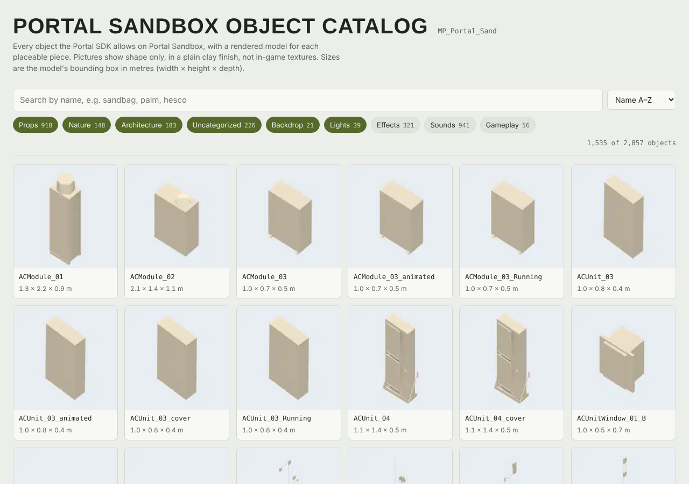

# BF6 Portal Object Catalog Maker

Build a searchable, picture-by-picture catalog of every object the Battlefield 6 Portal SDK allows on a map, straight from your own SDK install.



Building a Portal experience usually means scrolling through thousands of object names in Godot and guessing what `SoukHouse_01_768x1152_CV90_Mirrored_A_Propdress_C` looks like. This script renders every placeable model on a map and writes everything into one HTML page you can open in any browser:

- a clay-finish render of each placeable model, framed so the whole object is visible
- its bounding-box size in metres (width × height × depth)
- whether a TypeScript mod can spawn it at runtime (`mod.SpawnObject(mod.RuntimeSpawn_...)`) or it can only be placed in the level
- its `res://` scene path and its SDK directory, for finding it in Godot
- search, category filters (Props, Nature, Architecture, Lights, Sounds, Effects, Gameplay…) and sorting by name or size
- light and dark mode, and it works on a phone

The page is a single self-contained file of about 1.5–2 MB. Nothing is uploaded anywhere, and it works offline.

> **Unofficial fan tool.** This project is not made, endorsed or supported by EA or DICE. Battlefield and the Portal SDK belong to Electronic Arts. The script only reads files that ship with the SDK on your own machine.

---

## Contents

- [Requirements](#requirements)
- [Install](#install)
- [Quick start](#quick-start)
- [Options](#options)
- [Map names](#map-names)
- [Reading the catalog](#reading-the-catalog)
- [How it works](#how-it-works)
- [Troubleshooting](#troubleshooting)
- [Known limitations](#known-limitations)
- [Sharing catalogs](#sharing-catalogs)
- [Contributing](#contributing)

---

## Requirements

| What | Notes |
|---|---|
| Windows PC with the **Battlefield 6 Portal SDK** installed | The script uses the SDK's own files and its bundled Godot (`Godot_v4.6.3-stable_win64.exe`). |
| **The SDK's Godot project opened at least once** | Opening `GodotProject` in Godot imports the models into `GodotProject\.godot\imported`. Without that step there is nothing to render. |
| **Python 3.9 or newer** | Standard library only, so there are no packages to install. The Python that comes with the SDK (`venv`) works too. |

---

## Install

1. In your Portal SDK folder (the one that contains `FbExportData`, `GodotProject` and the Godot `.exe`), create a folder called `reference`.
2. Put `make_catalog.py` in it.

```
PortalSDK\
├── FbExportData\
├── GodotProject\
├── code\
├── Godot_v4.6.3-stable_win64.exe
└── reference\
    └── make_catalog.py     ← here
```

The script finds the SDK by looking in its own folder, then one and two folders up. It works wherever the SDK is installed, on any drive. Placing the script elsewhere is fine if you pass `--sdk`.

---

## Quick start

**Easiest:** double-click `make_catalog.py`. A window lists the maps; type a number (or a map code) and press Enter. The window stays open at the end so you can read where the page was saved.

**Or from a Command Prompt** (needed for the options below): open a Command Prompt in the `reference` folder. In File Explorer, type `cmd` in the address bar and press Enter. Then run:

```bat
python make_catalog.py --list
python make_catalog.py MP_Portal_Sand
```

If Windows says `python` is not recognised, use `py` instead of `python`.

While the script runs, a small Godot window appears for each batch of 200 models. Leave it alone; it closes by itself. A large map takes a few minutes. When the script finishes it prints where the page is:

```
Portal Sandbox (MP_Portal_Sand): 2857 objects allowed
Rendering 1535 models in 8 batch(es) with Godot_v4.6.3-stable_win64.exe
  batch 1 of 8 done
  ...
Done: 2857 objects, 1535 with pictures -> ...\reference\catalogs\portal-sandbox-object-catalog.html (1.7 MB)
```

Double-click the HTML file to open it in your browser.

---

## Options

```
python make_catalog.py MAP [--name "Nice Name"] [--out FILE.html] [--sdk PATH] [--godot EXE] [--work DIR] [--keep-going]
python make_catalog.py --list
```

| Option | What it does | Default |
|---|---|---|
| `MAP` | The map's level name, such as `MP_Abbasid`. Run `--list` to see them all. | — |
| `--list` | Lists every map code with its friendly name, then exits. | — |
| `--name "…"` | The map name shown on the page and used in the file name. | A built-in name for the map |
| `--out FILE` | Where to save the page. | `catalogs\<map-name>-object-catalog.html` next to the script |
| `--sdk PATH` | Your Portal SDK folder. | Found automatically, else `C:\Program Files\PortalSDK` |
| `--godot EXE` | The Godot to render with. | The `Godot*.exe` in the SDK folder |
| `--work DIR` | The scratch folder for renders and copied models. | `%TEMP%\bf6_catalog\<MAP>` |
| `--keep-going` | Resumes an interrupted run, re-using renders already in the scratch folder. | Off, so each run starts clean |

Examples:

```bat
:: Siege of Cairo, with the default name
python make_catalog.py MP_Abbasid

:: A Granite map with your own name on the page
python make_catalog.py MP_Granite_Marina_Portal --name "Marina"

:: Save to Documents instead of the SDK folder
python make_catalog.py MP_Isolated --out "%USERPROFILE%\Documents\tsuru-reef.html"

:: Finish a run that was interrupted
python make_catalog.py MP_Isolated --keep-going
```

You can delete the scratch folder once the page is built; the script prints its location at the end.

---

## Map names

| Code | Name used on the page |
|---|---|
| `MP_Abbasid` | Siege of Cairo |
| `MP_Aftermath` | Empire State |
| `MP_Aftermath_Portal` | Empire State (Portal) |
| `MP_Atoll` | Atoll |
| `MP_Badlands` | Blackwell Fields |
| `MP_Battery` | Iberian Offensive |
| `MP_Capstone` | Liberation Peak |
| `MP_Contaminated` | Contaminated |
| `MP_Dumbo` | Manhattan Bridge |
| `MP_Eastwood` | Eastwood |
| `MP_FireStorm` | Operation Firestorm |
| `MP_GolmudRailway` | Golmud Railway |
| `MP_Isolated` | Tsuru Reef |
| `MP_Limestone` | Saints Quarter |
| `MP_Outskirts` | New Sobek City |
| `MP_Plaza` | Plaza |
| `MP_Portal_Ocean` | Portal Ocean |
| `MP_Portal_Sand` | Portal Sandbox |
| `MP_Subsurface` | Subsurface |
| `MP_Tungsten` | Mirak Valley |
| `MP_Granite_ClubHouse_Portal` | Granite Clubhouse * |
| `MP_Granite_MainStreet_Portal` | Granite Main Street * |
| `MP_Granite_Marina_Portal` | Granite Marina * |
| `MP_Granite_MilitaryRnD_Portal` | Granite Military R&D * |
| `MP_Granite_MilitaryStorage_Portal` | Granite Military Storage * |
| `MP_Granite_TechCampus_Portal` | Granite Tech Campus * |
| `MP_Granite_Underground_Portal` | Granite Underground * |

\* Placeholder names. Use `--name` to set the real one, and see [Contributing](#contributing) if you know it.

`--list` reads the list of maps from your SDK (`FbExportData\level_info.json`), so a map added in a later SDK update appears there even before this table is updated. A map without a built-in name uses its code as the name.

---

## Reading the catalog

**Categories.** Pictured categories (Props, Nature, Architecture, Uncategorized, Backdrop, Lights) are on by default. Sounds, Effects and Gameplay objects have no model to draw, so they are listed by name only; tap their chips to show them. The page remembers your chip choices in that browser.

**Pictures** show shape only, in a plain clay finish lit from one side. They are not in-game textures. Every model is drawn from the same three-quarter angle and scaled to fill its tile, so judge size by the numbers, not the picture.

**Size** is the model's bounding box in metres, given as width (x) × height (y) × depth (z), as Godot reports it. Sort by **Largest first**, **Smallest first** or **Tallest first** to find a piece of the right size.

**From script** tells you whether a TypeScript mod can create the object at runtime:

- *Can be spawned (RuntimeSpawn)*: the object is in `RuntimeSpawn_Common` or the map's own `RuntimeSpawn_<Map>` list in the SDK's `index.d.ts`, so `mod.SpawnObject(mod.RuntimeSpawn_Common.<Name>, …)` works.
- *Level file only*: place it in Godot instead. Vehicles, for example, need a `VehicleSpawner`.

**Path** is the object's scene in the Godot project, such as `res://objects/props/Barrels_01.tscn`. You can drag it from Godot's FileSystem dock into your level.

---

## How it works

1. **Which objects.** It reads `FbExportData\asset_types.json`. An object belongs on the map if it has no level restrictions or if its `levelRestrictions` include the map.
2. **Which model.** Each object's `mesh` constant names a model. Godot stores the imported model as `<mesh>.glb-<md5 of "res://raw/models/<mesh>.glb">.scn` in `GodotProject\.godot\imported`, so the script can find it without opening the editor.
3. **Rendering.** It copies those models into a throwaway Godot project in the scratch folder and runs the SDK's Godot with a small render script. That script loads each model, gives it a clay material, frames it with an orthographic camera, and saves a 176 × 176 WebP. It also logs the bounding-box size. The models are rendered in batches of 200.
4. **Spawnability.** It reads the `RuntimeSpawn_*` enums from `code\types\mod\index.d.ts`.
5. **The page.** It embeds the data and the pictures in one HTML file. The page template is built into the script, so the script is the only file you need.

The script never changes anything in your SDK or Godot project. It only reads from them and writes to the scratch folder and the output file.

---

## Troubleshooting

| Problem | Fix |
|---|---|
| `python` is not recognized | Use `py make_catalog.py …`, or install Python from python.org and tick **Add python.exe to PATH**. |
| `Could not find Godot in …` | Pass the exe with `--godot "C:\path\to\Godot_v4.6.3-stable_win64.exe"`. |
| `N models were not found in GodotProject\.godot\imported` | Open the SDK's `GodotProject` in Godot once and wait for the import to finish, then run the script again. |
| The page lists objects but shows few or no pictures | Same cause as above, or Godot failed to start. Run Godot by hand once to check that it opens. |
| `PermissionError` when saving | Windows protects `Program Files`. Save elsewhere with `--out "%USERPROFILE%\Documents\catalog.html"`, or run the Command Prompt as administrator. |
| `Unknown map "…"` | Check the spelling with `--list`. Codes are case-sensitive. |
| A window flashes open and closes | Update to the latest `make_catalog.py`, which waits for Enter, or run it from a Command Prompt to see the message. |
| The run was interrupted | Run the same command with `--keep-going`. |
| Some pictures are blank or tiny | A few SDK objects are invisible helpers or have tiny meshes inside a large empty bounding box. That's expected. |

---

## Known limitations

- **Spawn lists on three Granite maps are guesses.** The SDK's `RuntimeSpawn_*` names don't match every map code. For `MP_Granite_ClubHouse_Portal`, `MP_Granite_MainStreet_Portal` and `MP_Granite_TechCampus_Portal`, the script assumes `Granite_ResidentialNorth`, `Granite_Downtown` and `Granite_TechCenter`. Treat "From script" on those maps with caution, and please report corrections.
- **Clay renders only.** Textures aren't drawn, so objects that differ only in colour or material look identical.
- **Windows first.** It was written for the Windows SDK. On Linux it also works with a Linux build of Godot passed through `--godot`, using `xvfb-run` when there's no display.
- **SDK updates.** New objects are picked up automatically. A change to the SDK's file layout could break the script.

---

## Sharing catalogs

The generated pages contain renders of EA's models from the SDK. Many Portal creators share reference material like this. If you publish catalogs, for example on GitHub Pages, label them as an unofficial fan reference and check the Portal SDK's terms first. A simple approach is to publish this script and let people generate their own catalogs.

To host the pages with **GitHub Pages**:

1. Put the HTML files in your repository, for example in a `catalogs/` folder.
2. In the repository settings, open **Pages** and set the source to your main branch.
3. Each page is then served at `https://<you>.github.io/<repo>/catalogs/<file>.html`.

---

## Contributing

Issues and pull requests are welcome, especially:

- the real names of the Granite maps
- confirmed `RuntimeSpawn_*` lists for the Granite maps
- reports from SDK versions other than the one this was built against (Godot 4.6.3)

When reporting a problem, include the command you ran, the full output, and your SDK version from `sdk.version.json`.

## License

*Choose a license before publishing. MIT is a common choice for small tools like this.*
